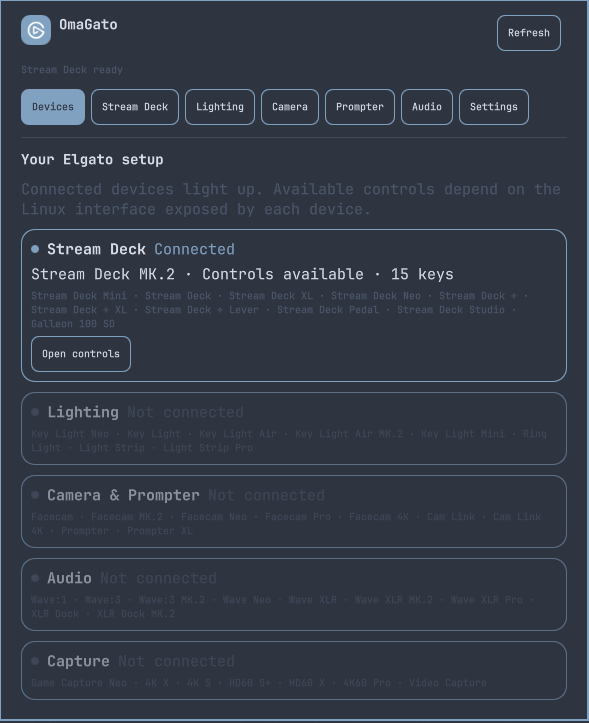

# OmaGato

Control your Elgato setup from the Omarchy bar. OmaGato brings Stream Deck keys, lights, cameras, audio, and a teleprompter into one panel that follows your Omarchy theme.




## Highlights

- Stream Deck: Click + to assign an installed app or system action to a key. Add scripts, websites, media controls, macros, and pages. Right click a key to clear it with confirmation.
- Multiple decks: Select a device to edit its own layout, brightness and dials. New devices start with your shared template. Link pages to active apps; on touch-enabled decks, assign tap/hold actions and swipe between pages.
- Your look: Choose from four Omarchy inspired icon themes, use your own images, and style empty keys. The interface follows your system language or a language you choose.
- More Elgato gear: Control compatible lights, adjust camera controls exposed by Linux, manage audio levels, and run a native Prompter view. [OpenXLR](https://github.com/emaspa/openxlr) adds controls for supported Wave and XLR devices.

## Install

```bash
omarchy plugin add https://github.com/JustVicinity/omagato
~/.config/omarchy/plugins/io.github.justvicinity.omagato/install.sh
```

Alternatively, open OmaGato and choose **Install / repair** in **Setup & health**. It opens a terminal showing progress; **Enable USB access** offers the USB rule when needed. No administrator access is requested until you choose that step.

The installer creates a Python environment and starts OmaGato's user service. You need Python 3 with `venv` and `pip`; Python packages are listed in `requirements.txt`. Some functions use optional system tools: `v4l2-ctl` for cameras, `avahi-browse` for light discovery, `pw-dump` and `wpctl` for audio, and `rsvg-convert` for custom SVG app icons. Media keys use `playerctl` when available or the system MPRIS bus. A physical Prompter needs a working display connection under Hyprland.

Python 3.11 or newer is required. Installation verifies package hashes and uses binary wheels from PyPI. Light addresses must be canonical IPs or `.local` names. Configured commands and scripts run with your user permissions, so use trusted sources. See [security limits and reporting](SECURITY.md) and the [0.7.1 changes](CHANGELOG.md).

If a Stream Deck is detected but cannot be opened, run `./setup-usb-access.sh` from the plugin directory to install the included USB access rule. That step asks for `sudo`.

## Update or remove

After `omarchy plugin update io.github.justvicinity.omagato`, run `install.sh` again to update the Python environment and service.

To remove OmaGato, run `uninstall.sh` in the plugin directory, then `omarchy plugin remove io.github.justvicinity.omagato`. Your key layouts and imported icons remain in `~/.config/omarchy-elgato/`. Use `uninstall.sh --purge-config` if you also want to delete them.

## Using multiple decks

Choose a deck in the Stream Deck tab. Its first change copies the shared template into an independent device profile. Later template edits affect only decks without a saved profile. Saved decks remain editable while disconnected. **Use shared template again** removes only the selected deck’s settings after confirmation. Language and icon theme remain shared across the panel. Settings follow a deck’s serial identity; without a serial, they follow its USB transport identity.

To switch pages automatically, select a running app or enter its Hyprland window class (for example `steam`) and choose **Link page** on the desired page. Other apps return that deck to the first page. Click a rule to remove it. Use `hyprctl activewindow -j` to find a window class. Touch-enabled devices offer separate tap and hold assignments per dial region; swipe left/right to change pages.

## Text editing

Type normally, use Ctrl+C/Ctrl+X/Ctrl+V, or right click for editing actions. Paste is read by a separate helper and limited to 60 KiB and two seconds; oversized or stalled offers are discarded. `wl-paste` from `wl-clipboard` is required for paste. Native middle-click paste and drop insertion are disabled. Native IME composition is temporarily unavailable in guarded editors; Unicode keyboard text and Unicode paste are supported.

## Troubleshooting

The device overview distinguishes **Ready** from **Detected · setup needed**. Only ready devices offer controls. Setup checks required Python packages, the controller and USB access; optional tool names explain which integrations need extra packages.

Run `bin/elgatoctl diagnostics` from the plugin directory for a small report suitable for an issue. It includes product names/IDs, control counts and setup checks; it excludes serials, personal paths, assignments and error messages. Nothing is uploaded automatically. See the [hardware testing checklist](docs/hardware-testing.md).

## Device support

OmaGato was tested with a Stream Deck MK.2. We could not physically test every Elgato model; controls for other devices depend on the interfaces they expose on Linux. The [device and feature matrix](docs/compatibility.md) shows what is implemented and what still needs testing or development. Reports from owners of other models are welcome.

The 0.7.1 security changes were validated through automated tests and local HTTP simulations, without physical Elgato hardware. The earlier MK.2 test does not validate these changes on hardware. See the [security validation results](docs/security-validation.md) for evidence and remaining compatibility uncertainty.

OmaGato is an independent community project, not official Elgato software. Its code is MIT licensed. The Elgato glyph comes from the [MIT licensed Elgato Icons project](https://github.com/elgatosf/icons); its license is included in `assets/brand/LICENSE.elgato-icons`. OpenXLR is a separate, optional application and is not bundled.
